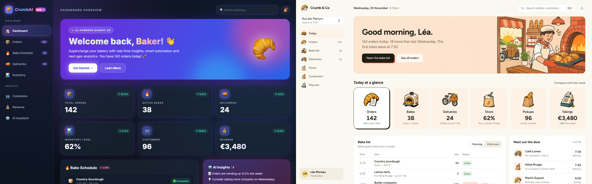

# Limora Unslop



**[Watch the demo](https://adrien-ninet.com/unslop)**

Your AI-built app or website looks like every other AI-built projects. That's because it's made of the same borrowed parts: stock icons, gradient heroes, empty empty states.

Limora Unslop is a free Claude skill that gives your product its own pictures. It finds the one true detail about how your product is used, draws every picture your screen needs with [Limora](https://limora.ai/?utm_source=limora-unslop&utm_medium=github) (icons, hero, card images, step illustrations, empty states), and rebuilds your screen around them.

By [Adrien Ninet](https://www.instagram.com/adrien.ninet/), designer.

> **Not the same as `unslop`.** There's a popular skill called [unslop](https://github.com/heydamir/unslop) by @heydamir that polishes code: spacing, type, color. **limora-unslop** is a different skill. It draws your product's own pictures with Limora, then rebuilds the screen around them. If you have both installed, say "use **limora-unslop**" so your agent picks this one.

## What it does

1. Optionally collects real references first, if you have a reference tool like Refero or Mobbin connected.
2. Reads your screen and finds what's borrowed.
3. Finds your product's world: who uses it, when, and which objects fill their day.
4. Gives you 3-4 visual directions, plus an image plan: every picture the screen needs, with its cost.
5. Draws the whole plan in one style with Limora, starting with the icons and the hero so you approve the look first.
6. Rebuilds the screen around them: quiet UI, one accent, specific copy.
7. Makes a short video of your screen fixing itself, ready to post.
8. Builds a before/after page with a drag-to-compare slider, to share the result.

It handles React, Tailwind and plain HTML/CSS. Start from your code, your website address or a screenshot.

## Install

Paste this repo's link into Claude Code and ask Claude to install the skill. Or run:

```bash
git clone https://github.com/Logiaweb/limora-unslop ~/.claude/skills/limora-unslop
```

Then **start a new session**. Skills load when a session starts, so a session that was already open won't see it, and may pick another skill with a similar name instead.

To update: `cd ~/.claude/skills/limora-unslop && git pull`

Then connect Limora for the drawings:

1. Create a free account at [limora.ai](https://limora.ai/?utm_source=limora-unslop&utm_medium=github). New accounts get enough credits to start with the icons and the hero.
2. Run `claude mcp add --transport http limora https://limora.ai/mcp`

## Use it

> /limora-unslop on my dashboard.

or "Use limora-unslop on my dashboard."

The skill stops once to let you pick a direction, and again before it spends credits.

Helper scripts in `scripts/` are plain Node with nothing to install. They cut an icon sheet into single icons (`split-sheet.mjs`), read the hero's exact edge color (`sample-color.mjs`), shrink Limora's full-size PNGs for the web (`shrink.mjs`), and build the before/after page (`compare-page.mjs`).

The video needs Playwright and ffmpeg: `npm i -D playwright && npx playwright install chromium`, and `brew install ffmpeg` on a Mac.

## Credits

The video's sound effects are free (CC0) recordings, credited here with thanks:

- Whoosh: ["Woosh" by 1bob](https://freesound.org/s/831936/) on Freesound
- Click: ["Mouse Click Sound" by Pixeliota](https://freesound.org/s/678248/) on Freesound
- Tick: "Switch 35" from [UI Audio by Kenney](https://kenney.nl/assets/ui-audio)
- Banner reveal: "Draw Knife 1" from [RPG Audio by Kenney](https://kenney.nl/assets/rpg-audio)

The pop and ding sounds are generated by the render script.
